# TP hand Graphical Control Interface

This project is a C++/Qt desktop control interface for the TP dexterous hand. It combines hardware communication, manual joint control, action presets, 3D URDF visualization, telemetry plotting, and optional camera-based hand pose input in one GUI application.

---

## Pre-requests

### Install necessary requests
```bash
sudo apt update

sudo apt install -y \
	  build-essential \
	  cmake \
	  git \
	  pkg-config \
	  qtbase5-dev \
	  qtbase5-dev-tools \
	  libqt5charts5-dev \
	  libyaml-cpp-dev \
	  libogre-1.12-dev \
	  libassimp-dev \
	  libtinyxml2-dev \
	  libopencv-dev \
	  python3 \
	  python3-dev \
	  python3-pip \
	  python3-numpy \
	  pybind11-dev
```

### Hand Detect
```bash
python3 -m pip install \
	  opencv-python \
	  mediapipe \
	  pyrealsense2
```

### UDE Glove Teleoperation (Optional)

Follow [Offical Document](https://hs7ghlauag.feishu.cn/docx/BlqKdFOSeoFQG1xzbV9ccNMMnzc) to install drive and SDK.

### Manus Glove Teleoperation (Optional)

Install Manus SDK follows [Manus Offical Guide](https://docs.manus-meta.com/latest/Plugins/SDK/Linux/)

The linux SDK `SDKClient_Linux` should be copied into `third_party` folder for compile. 

This program tested on Manus SDK `3.1.1`.

---

## CAN Device Install & Permissions

ZLG official documentation: [ZLG Linux Drive](https://manual.zlg.cn/web/#/42/1710)

### Simple Install Steps:
- Download drive from [https://manual.zlg.cn/web/#/146](https://manual.zlg.cn/web/#/146)
- Install libusb-1.0
  ```bash
  sudo apt-get install libusb-1.0-0
  ```
- Unzip the downloaded drive, enter unzipped folder and run
  ```bash
  sudo cp libusbcanfd.so /lib
  ```

### Permissions

If the current user is a regular user, performing device operations requires using `sudo` to invoke root privileges, or you can modify the device's access permissions using the following command:

```bash
sudo chmod 666 /dev/bus/usb/xxx/yyy
```
Where `xxx` corresponds to the Bus serial number of the USB device in the `lsusb` output, and `yyy` corresponds to the Device serial number. For example, the Bus serial number of USBCANFD is 004, and the Device serial number is 057.

To permanently modify user permissions, you need to modify the udev configuration by adding the file: `/etc/udev/rules.d/50-usbcanfd.rules`, with the following content:

```text
SUBSYSTEMS=="usb", ATTRS{idVendor}=="04cc", ATTRS{idProduct}=="1240", GROUP="users", MODE="0666"
```

Reload the udev rules using the following command:

```bash
udevadm control --reload
```

Finally, plugging and unplugging the device will apply the new permissions.

---

## Build & run
```bash
# Only GUI
cmake -S . -B build -D CMAKE_BUILD_TYPE=Release
# GUI + Manus + UDE
cmake -S . -B build -D CMAKE_BUILD_TYPE=Release -D BUILD_UDE_GLOVE=ON -D BUILD_MANUS_GLOVE=ON

cmake --build build --config Release

# Run
./build/grip_gui
```

---

## Usage

When the program starts, the main interface is displayed as shown below.

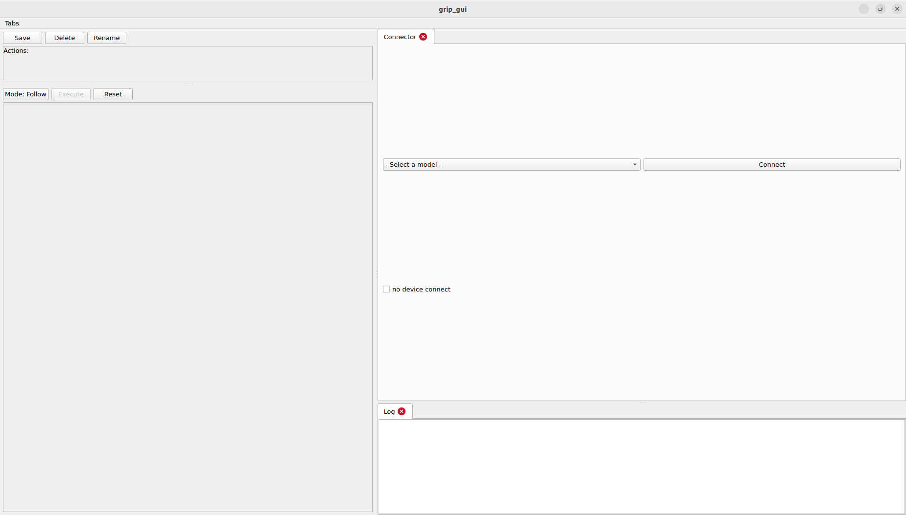

The interface is divided into two sections:

* **Left side**

  * **Action Panel** (top)
  * **Control Panel** (bottom)
* **Right side**

  * Multiple tabbed panels.

The panels on the right support **drag-and-drop tab reordering**. Tabs can also be detached into independent floating windows. By default, the **Connector Panel** and **Log Panel** are opened.

### Connector Panel

The **Connector Panel** is used to select the hand model and establish a connection with the CAN FD device.

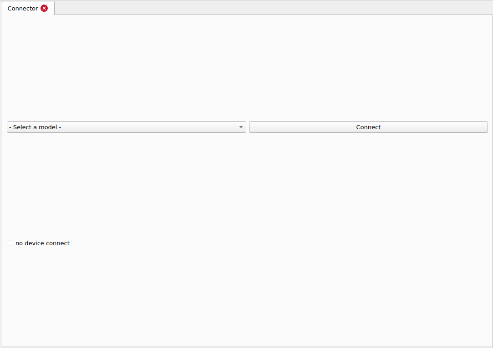

Functions:

1. **Model Selection**
   Select the dexterous hand model. The corresponding configuration file will be loaded automatically.

2. **No Device Connection**
   Launch the software without connecting to a CAN FD device. All software functions remain available except hardware communication.

3. **Connect / Disconnect**
   Connect to or disconnect from the CAN FD device. After a successful connection, the corresponding control widgets are loaded automatically. Disconnecting removes all hardware-related widgets.

After connecting successfully, the main interface becomes:

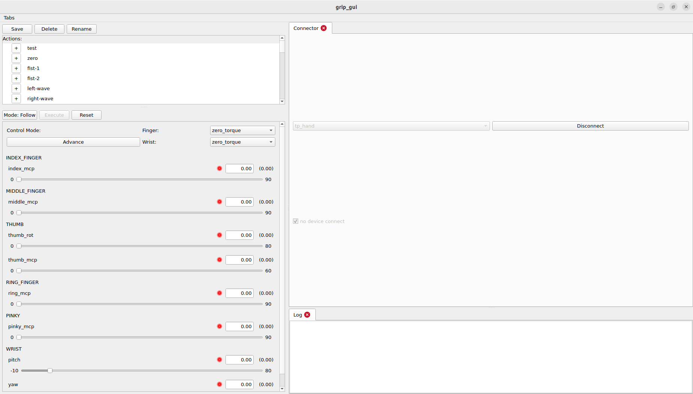

### Control Panel

The **Control Panel** is the primary interface for controlling the hand. It provides motion commands, operating mode selection, and real-time feedback.

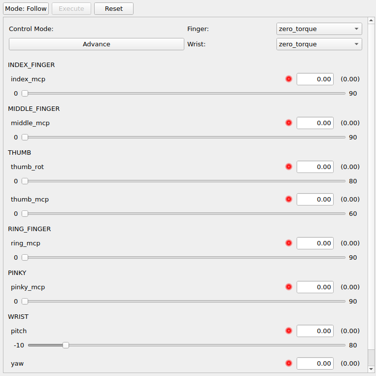

Functions:

1. **Command Mode (Follow / Setup)**

   * **Follow Mode**
     Every joint modification is transmitted immediately.

   * **Setup Mode**
     Joint values can be edited without sending commands. Press **Execute** to apply all target positions simultaneously.

2. **Execute**

   Sends all target joint positions to the hand in **Setup Mode**. This button is disabled in **Follow Mode**.

3. **Reset**

   Resets all joint target positions to zero.

4. **Control Mode (Finger / Wrist)**

   Switches between finger and wrist control. Since the finger and wrist mechanisms differ mechanically, each supports different control modes.

5. **Advanced**

   Opens the **Advanced Control Panel**. See the **Advanced Control Panel** section for details.

6. **Joint Controls**

   Each joint can be controlled using either an input box or a slider. Both controls are synchronized.

7. **Status Indicators**

   * **Green:** Joint is ready for control.
   * **Red:** Joint is not ready for control.

8. **Joint Feedback**

   Displays the real-time joint angle returned by the hardware.

### Action Panel

The **Action Panel** allows users to save predefined hand poses and execute them quickly.

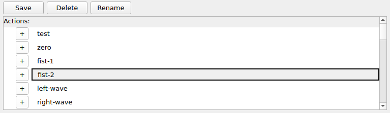

The currently selected action is highlighted with a **gray background** and a **black border**.

Functions:

1. **Save**

   Saves the current joint targets as a new action.

   Requirements:

   * An action name must be provided.
   * The name must be unique.

   While entering the name, the **Save** button changes to **Cancel**, allowing the operation to be canceled.

   > **Note**
   >
   > Only joint target values are saved. Control modes are **not** stored. Please verify the current control mode before executing a saved action.

2. **Delete**

   Deletes the selected action and removes all actions with the same name from the **Action Group Panel**.

3. **Rename**

   Renames the selected action. Any action with the previous name is also removed from the **Action Group Panel**.

4. **Add (+)**

   Adds the selected action to the current action group.

5. **Action Name**

   Clicking an action immediately executes it and marks it as the currently selected action.

### Log Panel

The **Log Panel** displays system messages, warnings, and error information.

Example:

Information log:

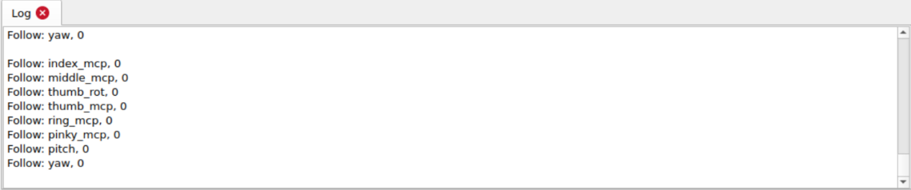

Error log:

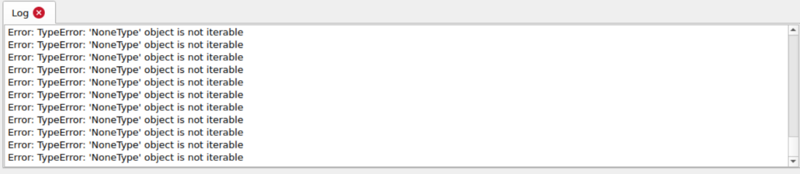

### Action Group Panel

The **Action Group Panel** allows multiple actions to be combined into an action sequence that can be played automatically.

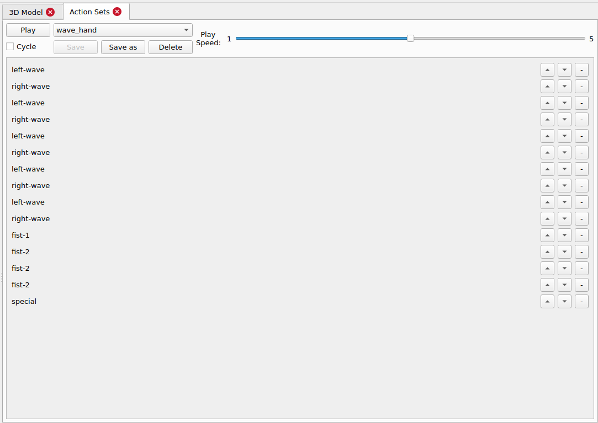

Functions:

1. **Play**

   Plays the currently selected action group.

2. **Action Group Selection**

   Select an existing action group or create a new one.

3. **Cycle**

   Enables or disables continuous looping.

4. **Save**

   Saves the current action group.

   When creating a new group, a unique group name must be provided.

5. **Save As**

   Saves the current group under a new name.

6. **Delete**

   Deletes the selected action group.

7. **Playback Speed**

   Adjusts playback speed.

   * **1:** Slowest
   * **5:** Fastest

8. **Move Up / Down**

   Changes the execution order of actions.

9. **Remove (-)**

   Removes the selected action from the action group.

### Advanced Control Panel

The **Advanced Control Panel** provides independent control settings for each joint.

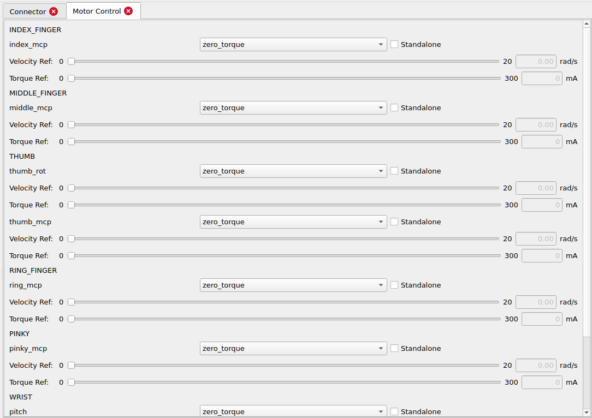

Enabling **Standalone** allows a joint to use its own control mode instead of following the global mode selected in the **Control Panel**.

> **Note**
>
> **Velocity Reference** and **Torque Reference** are only available when the control mode is **MIT Torque**.

### Diagram Panel

The **Diagram Panel** visualizes real-time or recorded hardware data.

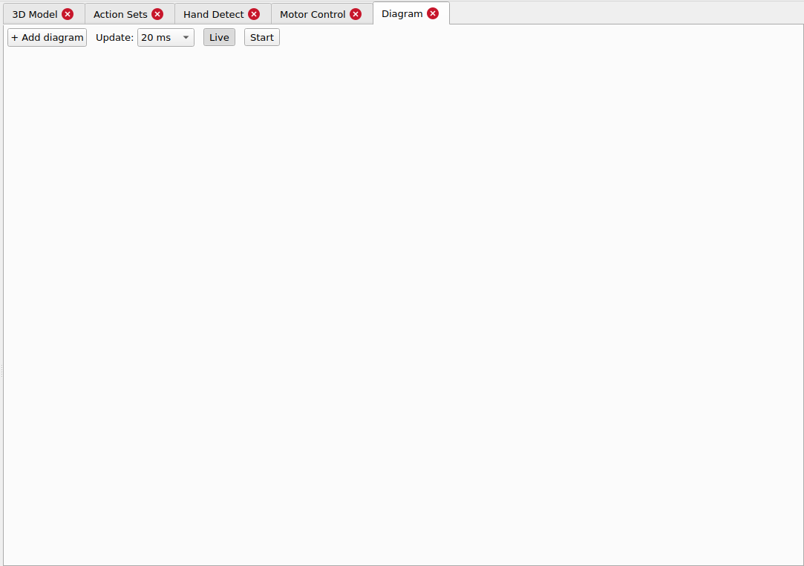

Functions:

1. **Add Diagram**

   Creates a new chart. Multiple charts can be added simultaneously.

2. **Update Interval**

   Selects the chart refresh rate.

3. **Live / History**

   * **Live:** Displays real-time data.
   * **History:** Pauses updates for inspection of previously recorded data.

4. **Start / End**

   Starts or stops data recording.

After adding a chart:

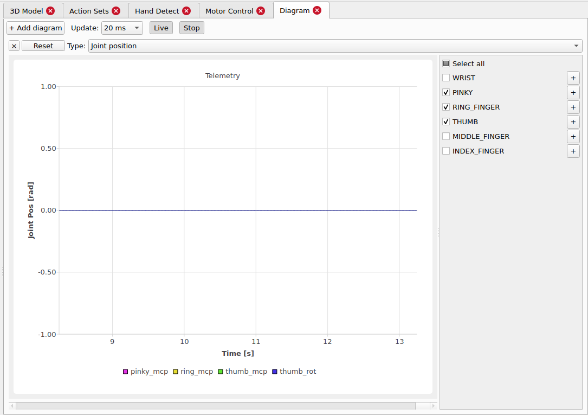

#### Chart Controls

1. **Close**

   Removes the chart.

2. **Reset**

   Restores the default zoom level.

3. **Data Type**

   Selects the displayed data, including:

   * Joint Position
   * Joint Velocity
   * Motor Hall Position
   * Motor Speed
   * Motor Torque

4. **Selection Panel**

   Selects the joints or motors to display.

   * **Select All** adds every available signal.
   * Click the **+** icon to expand joint or motor groups.

5. **History Mode**

   Drag the mouse to select an area and zoom in for detailed analysis.

### URDF Display

The URDF model path can be specified in the dexterous hand configuration file. The software loads the model automatically and synchronizes it with the **Control Panel**, allowing the visualization to reflect both command targets and real-time feedback.

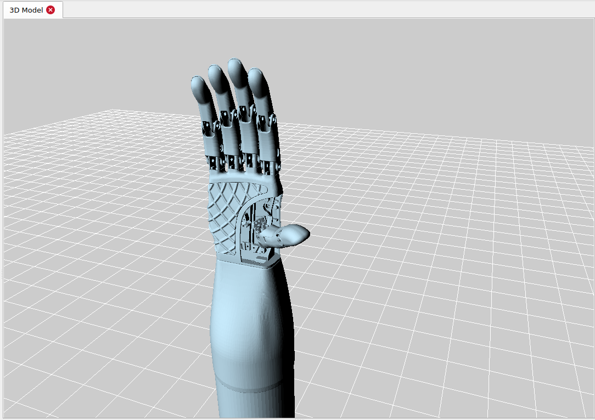

## Camera Controls

| Operation                  | Function          |
| -------------------------- | ----------------- |
| Left Mouse Button          | Rotate the camera |
| Mouse Wheel                | Zoom in / out     |
| Middle Mouse Button (Drag) | Pan the camera    |

---

## License

This software is provided under the [Apache License 2.0](LICENSE).
